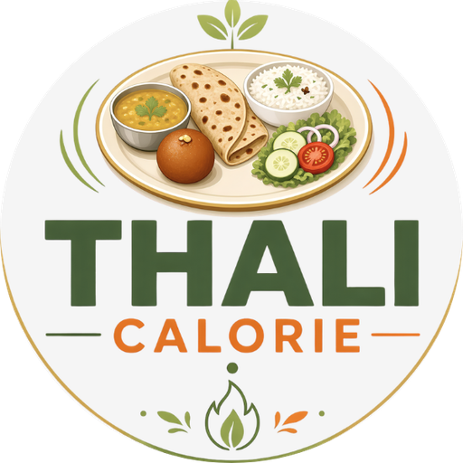

# Thali Calorie

Snap a full Indian thali and get a **calorie range for each dish**, then log your day by photo, voice or search.

[**Get it on Google Play**](https://play.google.com/store/apps/details?id=com.lexcore.thali_calorie)

> **Showcase repository.** This repo presents a live product we built. The application source code is private.

## Features
- **Thali photo scan:** dishes, quantities and a calorie range, editable before saving.
- **Family split:** share one thali photo across several people.
- **Voice logging** in Hindi, Hinglish or English ("lunch mein do roti aur dal").
- **109 Indian dishes** built in, plus custom dishes and a recipe calculator.
- **Food modes:** Navratri vrat, Ramzan (sehri/iftar) and festival week.
- Daily range, protein/carbs/fat, water tracker, streaks and weekly trends.
- Diet profiles: veg, egg, non-veg, vegan, Jain. English and Hindi.
- Privacy: the photo is deleted after the scan and the food log stays on the phone.

Calorie values are estimates shown as ranges, not medical advice.

## Built with
Flutter · Dart · vision AI · offline-first local storage

---
Built by <a href="https://github.com/Cortina-Lab">Cortina Lab</a>, a <a href="https://lexcoredev.com/">Lexcore Dev</a> studio · © 2026 Lexcore Enterprises Pvt. Ltd. · <a href="https://lexcoredev.com/cortinalab.html">Hire us</a>
